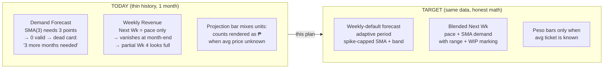
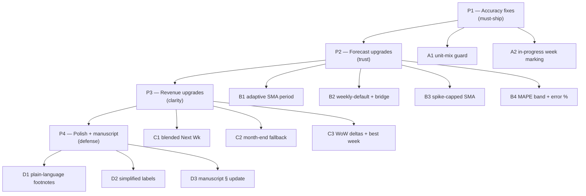
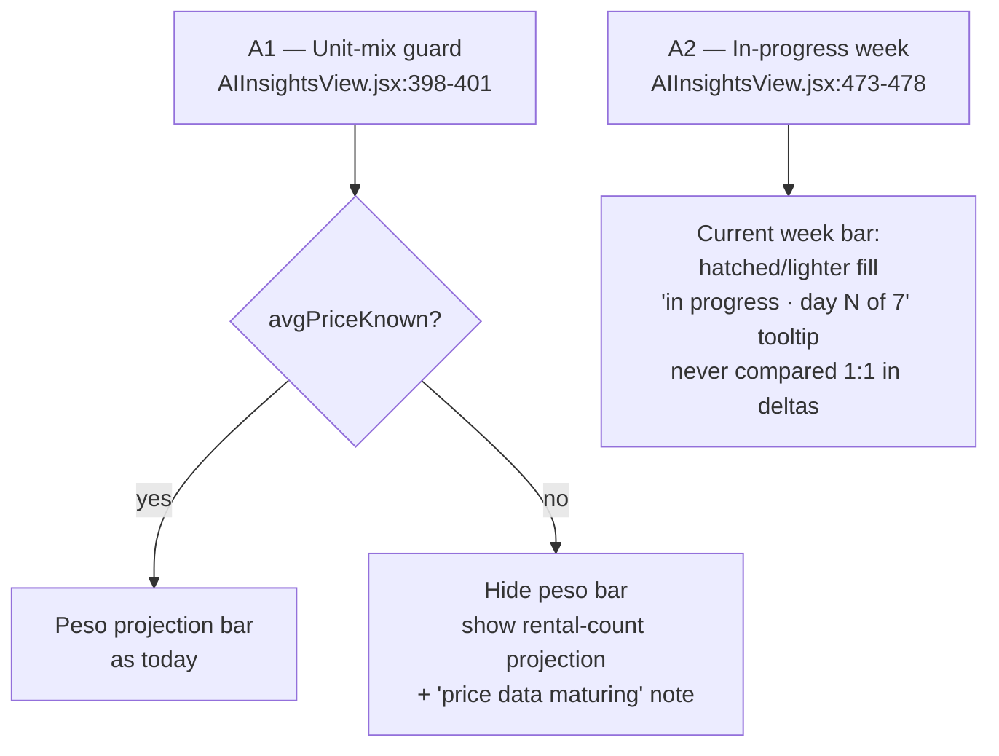
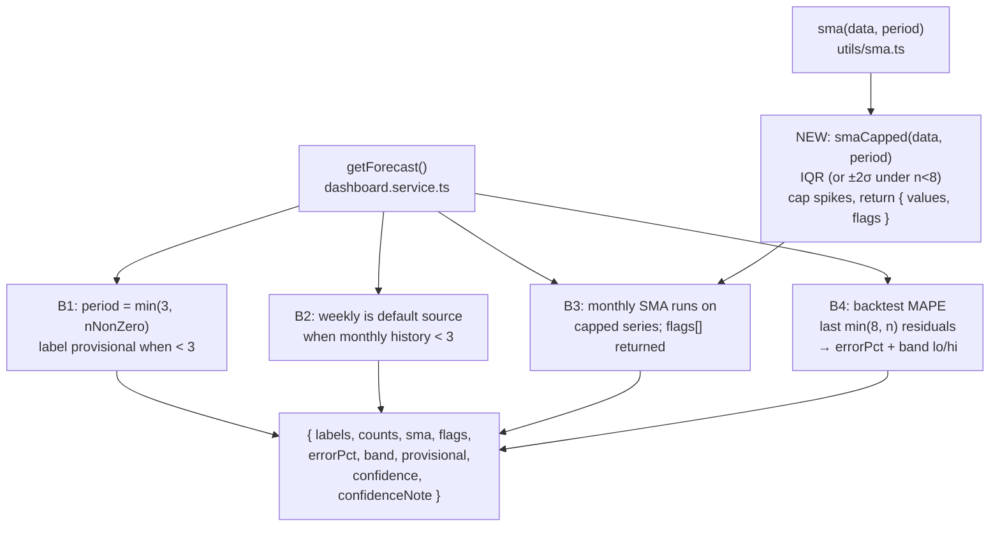
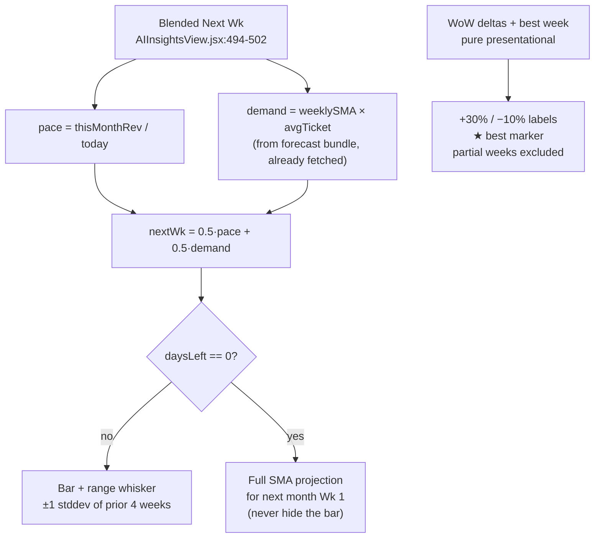
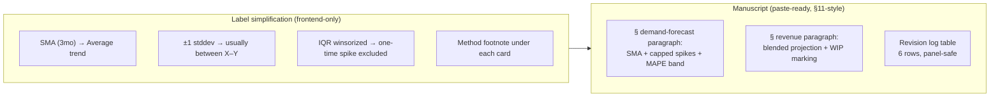
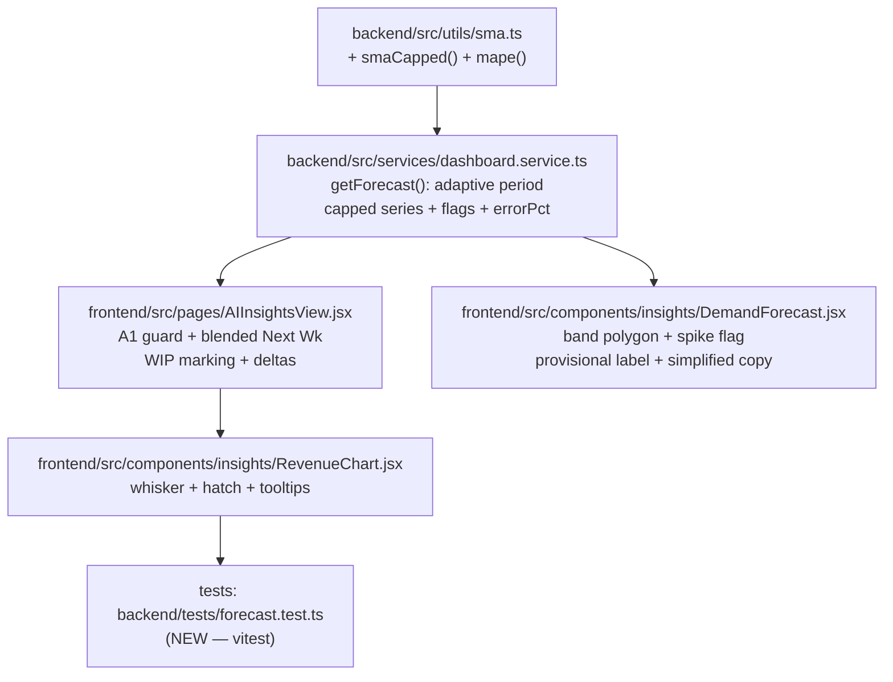
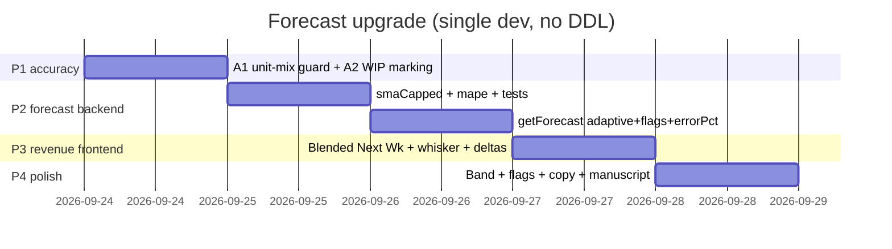
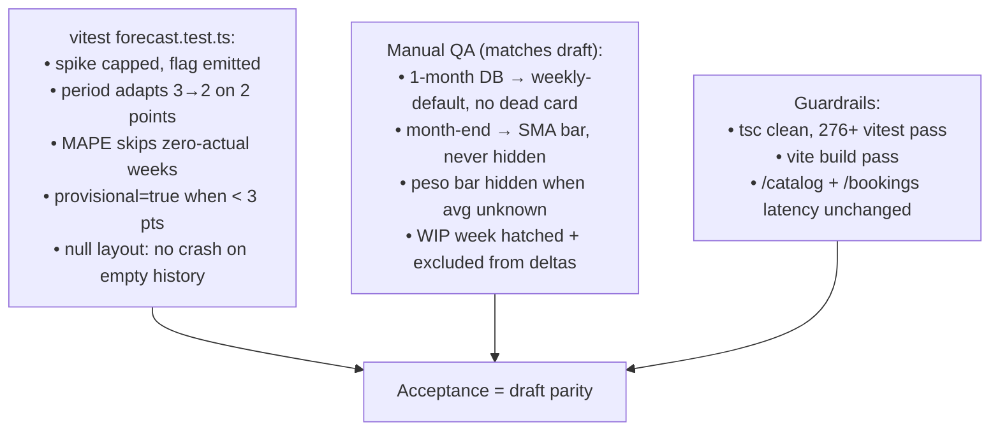

# Forecast & Revenue Upgrade Plan — SMA, Demand Forecast & Weekly Revenue

> Scope: make the Demand Forecast and Weekly Revenue cards accurate, admin-useful, and
> informative on thin history (1 month today). No schema changes, no new dependencies,
> no new external APIs. Matches the simplified draft in `docs/forecast-draft.html`.
> Render this file in any Mermaid-capable viewer (GitHub, VS Code + Mermaid preview).

---

## 0. Problem Statement (what the screenshots show)



Root cause is not the UI — it is **SMA(3) on 1 data point** plus a **pace-only revenue
projection**. Every fix below works on the data the boutique already has.

---

## 1. Workstream Map



**Ship order: P1 → P2 → P3 → P4.** Each phase is independently releasable; P1 alone
fixes a real mislabeling bug.

---

## 2. P1 — Accuracy Fixes



- **A1** — one-line guard. Today `forecastRevValue` falls back to a rental *count* that
  still renders as a *peso* bar. With 1 month of history this is the live bug.
- **A2** — data already available (`weekIdx` trim exists); only the *marking* is new.
  Frontend-only, zero backend change.

---

## 3. P2 — Forecast Upgrades (backend)



API contract (additive — old clients ignore new fields):

```json
{
  "counts": [6, 9, 7, 14, 8, 10, 9, 12],
  "sma": [null, null, 7.3, 8.7, 9.7, 10.7, 9.0, 10.3],
  "flags": [{ "index": 3, "reason": "bulk booking — capped at 9" }],
  "errorPct": 12,
  "provisional": true,
  "confidence": "medium",
  "confidenceNote": "Based on 8 weeks of history · medium confidence · error ±12%"
}
```

Rules:
- Capping never deletes data — bars show true counts; only the *average* uses capped
  values. Flag text is user-facing, no jargon ("bulk booking", never "IQR winsorized").
- MAPE skips zero-actual periods (division-by-zero guard).
- `confidence()` thresholds unchanged (`low <4mo, medium <8mo`); the note gains `· error ±X%`.
- Cache keys unchanged (`forecast:{period}:{granularity}`); warmer in
  `dashboard.service.ts:12-20` needs no edit.

---

## 4. P3 — Revenue Upgrades (mostly frontend)



- Uses the already-fetched forecast bundle — **zero extra requests**.
- Range whisker = sample stddev of the 4 completed weekly revenues (n<2 → hide whisker,
  show point only).
- Tooltip copy: *"Projected, usually between ₱19k–₱25k"* (plain language per draft).

---

## 5. P4 — Polish + Manuscript



Footnote copy (exact strings for the draft):
- Forecast: *"May's bulk-booking spike is excluded from the average so it doesn't
  inflate the forecast. December is adjusted for the Christmas rush."*
- Revenue: *"Next week blends this month's daily pace with the rental trend × ₱1,450
  average ticket. Wk 4 is still ongoing, so it will naturally look lower."*

---

## 6. File Map



| File | Change | Lines |
|---|---|---|
| `backend/src/utils/sma.ts` | add `smaCapped`, `mape` (pure fns) | +40 |
| `backend/src/services/dashboard.service.ts` | `getForecast` adaptive + flags + errorPct | ~+50 |
| `frontend/src/pages/AIInsightsView.jsx` | A1/A2/C1/C2/C3 | ~+60 |
| `frontend/src/components/insights/DemandForecast.jsx` | band + flags + copy | ~+40 |
| `frontend/src/components/insights/RevenueChart.jsx` | whisker + hatch + tooltips | ~+30 |
| `backend/tests/forecast.test.ts` | NEW | +80 |

No DDL. No env changes. No new packages (band/whisker/hatch are inline SVG).

---

## 7. Build Order (Gantt)



---

## 8. Test & Acceptance Checklist



Capstone defense line: *"The forecast keeps the approved SMA engine and adds
standard honest-forecasting practice: spike capping, adaptive windowing, and a
backtest-measured error band — so the system reports its own uncertainty instead
of a false-precise point."*
